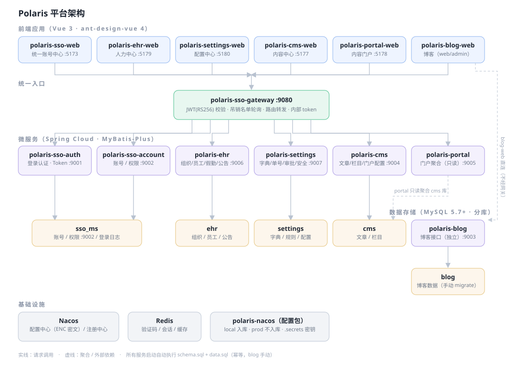

# Polaris Server

Polaris 一体化企业平台后端：统一认证 + 人力中心 + 配置中心 + 内容中心 + 门户/博客。
Spring Cloud 微服务架构，Nacos 配置/注册中心，Gateway 统一入口，MySQL 分库存储。

## 一、架构总览



## 二、仓库结构

```
polaris-server/
├── polaris-common/                 # 公共依赖（所有服务依赖它）
│   └── src/main/java/.../common/
│       ├── exception/              # BizException / ErrorCode 统一异常
│       ├── response/               # R<T> 统一响应体
│       ├── auth/                   # JWT 校验、LoginUser 解析
│       └── config/                 # EncryptedPropertyEnvironmentPostProcessor（ENC 解密）
├── polaris-gateway/                # 统一网关 :9080
├── polaris-sso/                    # 统一认证与账号中心
│   ├── polaris-sso-auth/           #   登录认证 :9001
│   └── polaris-sso-account/        #   账号/权限 :9002
├── polaris-ehr/                    # 人力中心
│   └── polaris-ehr-service/        #   :9006
├── polaris-settings/               # 配置中心
│   └── polaris-settings-service/   #   :9007
├── polaris-cms/                    # 内容中心
│   └── polaris-cms-service/        #   :9004
├── polaris-portal/                 # 门户聚合 :9005
├── polaris-blog/                   # 博客 :9003（独立，无 Nacos 接入）
├── polaris-nacos/                  # Nacos 配置包 + 导入工具 + 密钥材料
│   ├── config/local|prod/          #   各环境配置集（均入库；prod 仅参考，线上不用这份）
│   ├── .env / .env.example         #   配置主密钥（不入库）/ 模板
│   ├── .secrets/                   #   JWT 私钥、app-secret、内部 token（不入库）
│   ├── import-config.py            #   配置推送脚本
│   └── README.md                   #   文件级详细说明
├── docs/architecture.svg           # 架构图
└── update.md                       # 变更记录（不入库，按日期倒序）
```

## 三、模块明细

### 1. polaris-gateway —— 统一网关（:9080）

所有前端请求的唯一入口。

- **JWT 校验**：用打进 jar 的 `jwt-public.pem`（RS256 公钥）验签，解析出 `LoginUser`（userId/账号/角色）
- **吊销名单**：定期从 sso-auth 轮询已注销/踢下线的 token jti，命中即 401
- **路由转发**：按 path 前缀路由到各服务（`/auth/**`→sso-auth、`/accounts/**`→sso-account、`/ehr/**`→ehr……）
- **内部调用透传**：服务间 Feign 调用携带内部 token 头，网关与各服务共同校验

### 2. polaris-sso —— 统一认证与账号中心（库：`sso_ms`）

| 子模块 | 端口 | 职责 |
|---|---|---|
| sso-auth | 9001 | 登录（**账号/邮箱双登录**）、图形/邮箱验证码、access token(2h)+refresh token 签发与刷新、登出吊销、登录失败计数与锁定（阈值/锁定时长来自安全配置） |
| sso-account | 9002 | 账号 CRUD（开户按安全配置生成**随机初始密码**或固定密码）、启停/锁定、重置密码、角色管理、权限码、菜单权限播种 |

主要表：

| 表 | 说明 |
|---|---|
| `sso_account` | 账号（username/email 双唯一，BCrypt 密码，关联 ehr 员工） |
| `sso_role` / `sso_account_role` | 角色与绑定 |
| `sso_permission` / `sso_role_permission` | 权限码（如 `notice:view`、`announcement:manage`）与授权 |
| `sso_login_log` | 登录日志（成功/失败、IP、UA） |

### 3. polaris-ehr —— 人力中心（:9006，库：`ehr`）

| 业务域 | 说明 | 主要表 |
|---|---|---|
| 组织架构 | 集团/公司/部门树，path 祖先链、负责人、排序、拖拽调整 | `ehr_org_node` |
| 员工管理 | 在职/离职、入转调离、工号自动生成 | `ehr_employee`、`ehr_employee_change` |
| 假勤 | 请假/转正/离职申请单，接入审批流 | `ehr_leave`、`ehr_regularize`、`ehr_resign` |
| 通知公告 | 富文本、全员/部门定向（含子部门，按员工组织 path 祖先链判定）、置顶、草稿/发布/下架、编号规则 NOTICE-、幂等已读（唯一键 `(announcement_id, account_id)`，仅首次 +1 阅读数） | `ehr_announcement`、`ehr_announcement_read` |

表结构变更由 `AnnouncementSchemaInitializer` 等启动器幂等执行（CREATE IF NOT EXISTS / 缺列 ALTER），无需手工 DDL。

### 4. polaris-settings —— 配置中心（:9007，库：`settings`）

| 业务域 | 说明 | 主要表 |
|---|---|---|
| 数据字典 | 类型 + 字典项，按应用分组（如通知类型 `ehr.announcement_category`：节假日/表彰/部门/制度/部门任命/其他） | `cfg_dict_type`、`cfg_dict_item` |
| 单号规则 | 前缀 + 流水位数 + 日期段，供 EHR 公告编号（11304）、工号等使用 | `cfg_code_rule` |
| 审批配置 | 审批模板、业务场景、业务点、消息配置；渲染模式：分组卡片（sections JSON）/ 自定义页面路由（iframe 拼 instanceId） | `cfg_approval_*` |
| 安全配置 | 初始密码规则（`initial_password_mode`：RANDOM 默认 / FIXED）、密码复杂度、登录失败锁定阈值与时长、会话超时 | `cfg_security_config` |

### 5. polaris-cms —— 内容中心（:9004，库：`cms`）

- 文章：Markdown 正文、封面、栏目归属、草稿/发布/下架、发布时间
- 栏目：树形结构、排序
- 门户配置：首页 Banner、推荐位
- 主要表：`cms_article`、`cms_column`、`cms_portal_config`

### 6. polaris-portal —— 门户聚合（:9005）

面向访客的只读聚合接口（Banner、推荐文章、栏目文章列表、文章详情），数据直读 `cms` 库，无独立表。

### 7. polaris-blog —— 博客（:9003，库：`blog`）

博客文章/标签/分类接口，独立链路不经网关。schema 在 `resources/db/`，`sql.init=never`，**手动 migrate**。

### 8. polaris-common —— 公共依赖

- `R<T>` 统一响应体（code/message/data）
- `BizException` + `ErrorCode` 统一异常码，全局异常处理器兜底
- JWT 工具、`LoginUser` 上下文
- `EncryptedPropertyEnvironmentPostProcessor`：启动期用 `SSO_CONF_KEY`（AES-256-GCM）解密配置里的 `ENC(...)` 密文

## 四、关键机制

### 认证与调用链

```
登录：POST /auth/login → sso-auth 校验（账号或邮箱 + BCrypt + 失败锁定）
      → RSA 私钥签发 JWT → 前端持有 access/refresh token
请求：前端 → 网关（公钥验签 + 吊销名单）→ 业务服务（LoginUser 上下文）
内部：服务间 Feign 调用带内部 token 头，与网关共同校验
```

### 配置加载

```
application.yml（入库，无敏感项）
  → Nacos（config/local 的 ENC(...) 密文 + ${ENV} 占位）
  → EncryptedPropertyEnvironmentPostProcessor 用 SSO_CONF_KEY 解密
  → 敏感项也可直接走环境变量覆盖
```

### 数据库初始化（sql.init）

- sso_ms / ehr / settings / cms 四库：`spring.sql.init.mode=always`，启动自动执行 `resources/schema.sql`（`CREATE TABLE IF NOT EXISTS`）+ `data.sql`（`INSERT IGNORE` 种子数据），幂等可重复
- blog：`never`，手动执行 `resources/db/migrate`

### 编号与字典

- 业务编号统一走 settings 单号规则（前缀 + 日期 + 流水），如公告 `NOTICE-20261109-0001`
- 业务枚举统一走数据字典，前端下拉实时取字典值，不再写死

## 五、本地启动

```bash
# 0. 前置：MySQL 5.7+（root/root，创建空库 sso_ms/ehr/settings/cms/blog 即可）、Redis、Nacos
# 1. 导入 Nacos 配置
python polaris-nacos/import-config.py --env local
# 2. 编译（JDK 17，Maven 3.6.3+）
mvn -q compile
# 3. 启动顺序：Gateway → sso-auth / sso-account → 其余业务服务
#    无需手动建表/导数据（见上节 sql.init）
```

端口速查：gateway **9080** · auth **9001** · account **9002** · blog **9003** · cms **9004** · portal **9005** · ehr **9006** · settings **9007**

## 六、开发指引

| 要做什么 | 怎么做 |
|---|---|
| 新增接口 | 对应服务 `module/xxx/controller` 加 `@RestController`，返回 `R<T>`；权限用权限码注解 |
| 新增表 | 实体 + Mapper（MyBatis-Plus），DDL 加进 `resources/schema.sql`（IF NOT EXISTS），种子加 `data.sql`（INSERT IGNORE） |
| 新增权限码 | sso-account 播种类里加，绑定角色 |
| 新增字典 | settings 配置中心页面维护，或 `data.sql` 加 `cfg_dict_*` 种子 |
| 新增业务编号 | settings 加 `cfg_code_rule`，业务侧调编号服务取号 |

## 七、约定

- **敏感配置**：入库配置只含 `ENC(...)` 密文或 `${ENV}` 占位；私钥、token、主密钥在 `polaris-nacos/.secrets/`、`.env`（均已 gitignore）；`config/prod/` 已入库但仅作参考（无真实敏感值，线上不使用）
- **初始密码**：默认随机生成（`initial_password_mode=RANDOM`），配置中心可改固定模式
- **异常**：关键链路不许吞异常，业务错误抛 `BizException(ErrorCode)`
- **上传目录**：`polaris-uploads*/` 运行期产生，不入库
- **变更记录**：`update.md` 维护在仓库根目录（不入库），所有改动按日期倒序追加
